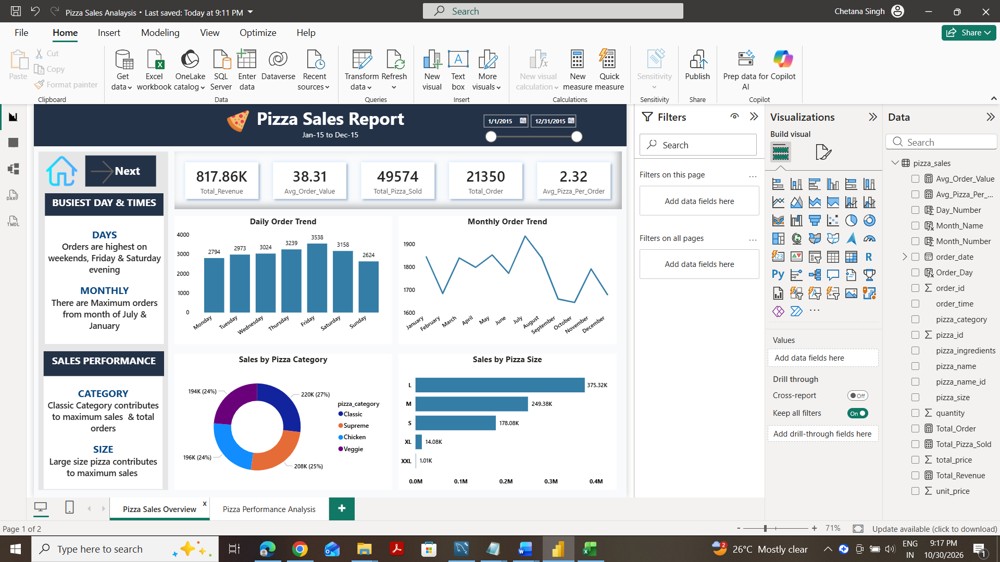
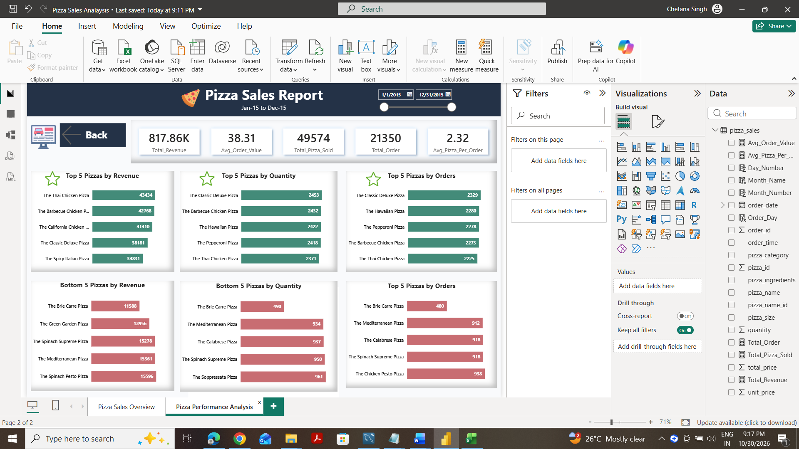

🍕 Pizza Sales Analysis | MySQL & Power BI

📌 Project Overview
This project analyzes pizza sales transaction data using MySQL and Power BI to understand revenue, order trends, product popularity, and sales performance. SQL is used to calculate business metrics and explore patterns, while interactive Power BI dashboards make the results easier to review.
Business Questions
- How much revenue does the pizza business generate?
- What is the average order value, and how many pizzas are sold per order?
- Which weekdays and months have the most orders?
- How do pizza categories and sizes contribute to revenue?
- Which pizzas rank highest and lowest by revenue, quantity sold, and number of orders?
  
🛠️ Tools & Skills
Tool	Purpose
MySQL	SQL queries, aggregations, grouping, ranking, and date analysis
Power BI	Interactive dashboards and visual reporting
DAX	KPI calculations and measures
Power Query	Data preparation and data type handling
CSV	Source transaction data

📂 Dataset Overview
The source file, Pizza_Sales.csv, contains 48,620 transaction rows and 12 columns.
Column	Description
pizza_id	Pizza line-item identifier
order_id	Order identifier
pizza_name_id	Pizza product code
quantity	Quantity of pizzas sold
order_date	Order date
order_time	Order time
unit_price	Unit price
total_price	Sales amount for the line item
pizza_size	Pizza size
pizza_category	Pizza category
pizza_ingredients	Pizza ingredients
pizza_name	Pizza product name

Note: The dataset does not explicitly specify a currency, so revenue is shown without a currency symbol.

📊 Key Performance Indicators (KPIs)
KPI	Result
Total Revenue	817,860.05
Average Order Value	38.31
Total Pizzas Sold	49,574
Total Orders	21,350
Average Pizzas per Order	2.32

KPI definitions:
- Total Revenue: Sum of total_price.
- Average Order Value: Total Revenue ÷ distinct orders.
- Total Pizzas Sold: Sum of quantity.
- Total Orders: Distinct count of order_id.
- Average Pizzas per Order: Total Pizzas Sold ÷ Total Orders.
  
📈 Power BI Dashboards

### Dashboard 1 — Pizza Sales Overview

Objective: Track overall sales performance and ordering patterns.

Visualizations:
- Total Revenue, Average Order Value, Total Pizzas Sold, Total Orders, and Average Pizzas per Order
- Daily trend of total orders
- Monthly trend of total orders
- Revenue contribution by pizza category
- Revenue contribution by pizza size
Business value: Provides an at-a-glance view of sales KPIs and helps identify changes in demand and the relative contribution of different pizza categories and sizes.

### Dashboard 2 — Pizza Performance Analysis

Objective: Compare the best- and lowest-performing pizzas across different measures.

Visualizations:
- Top 5 and Bottom 5 pizzas by revenue
- Top 5 and Bottom 5 pizzas by quantity sold
- Top 5 and Bottom 5 pizzas by distinct orders
Business value: Helps distinguish products that generate revenue from those that sell in high quantities or appear in many orders. These rankings support further investigation of menu performance.

🔎 SQL Analysis
The SQL analysis covers:
1. Revenue and order KPIs
2. Daily and monthly order trends
3. Percentage of sales by pizza category and size
4. Total pizzas sold by category
5. Top 5 and Bottom 5 pizzas by revenue, quantity, and total orders
   
Example 1 — Total Revenue
SELECT SUM(total_price) AS Total_Revenue
FROM pizza_sales;

Example 2 — Average Order Value
SELECT
    SUM(total_price) / COUNT(DISTINCT order_id) AS Average_Order_Value
FROM pizza_sales;

Example 3 — Top 5 Pizzas by Revenue
SELECT
    pizza_name,
    SUM(total_price) AS Total_Revenue
FROM pizza_sales
GROUP BY pizza_name
ORDER BY Total_Revenue DESC
LIMIT 5;

Example 4 — Bottom 5 Pizzas by Quantity
SELECT
    pizza_name,
    SUM(quantity) AS Total_Quantity
FROM pizza_sales
GROUP BY pizza_name
ORDER BY Total_Quantity ASC
LIMIT 5;

Date handling: Confirm the date format in your imported dataset before applying STR_TO_DATE() in MySQL or converting dates in Power Query.

💡 Business Insights & Interpretation
- Revenue and orders: Total revenue and average order value summarize overall sales performance and purchasing activity.
- Demand patterns: Weekday and monthly order trends can highlight periods worth investigating for staffing and inventory planning.
- Category and size contribution: Revenue shares reveal how different product groups contribute to total sales.
- Product rankings: Comparing revenue, quantity, and order counts offers different perspectives on pizza performance; the top seller by quantity may not be the top seller by revenue.
- Decision support: These analyses provide a starting point for evaluating menu performance and planning further business investigations.
These are interpretations of the analyses performed, not claims of measured profit improvement or realized business savings.

🎯 Skills Demonstrated
- Writing MySQL queries using SUM(), COUNT(DISTINCT), GROUP BY, ORDER BY, and LIMIT
- Calculating sales KPIs and percentage contributions
- Working with date fields and order trends
- Preparing data in Power Query
- Creating DAX measures
- Building interactive Power BI reports
- Translating sales data into business-focused visualizations
  
📁 Repository Structure
Pizza-Sales-Analysis/
│
├── README.md
├── Dataset/
│   └── Pizza_Sales.csv
├── SQL_Queries/
│   └── Pizza_Sales_SQL_Queries.sql
├── PowerBI/
│   └── Pizza Sales Analaysis.pbix
└── Dashboard_Screenshots/
    ├── 01_Sales_Overview.png
    └── 02_Pizza_Performance.png
    
Project Files
- [Dataset](Dataset/Pizza_Sales.csv)
- [SQL Queries](SQL_Queries/Pizza_Sales_SQL_Queries.sql)
- [Power BI Report](PowerBI/Pizza%20Sales%20Analaysis.pbix)
- [Sales Overview Screenshot](Dashboard_Screenshots/01_Sales_Overview.png)
- [Pizza Performance Screenshot](Dashboard_Screenshots/02_Pizza_Performance.png)
  
Upload reminder: These links and images work only after the files have been uploaded to the exact folders and filenames shown above. Rename the Power BI file or update its link if needed.

✅ Project Conclusion
This project combines SQL analysis with Power BI reporting to explore pizza sales performance, customer ordering patterns, and product-level results. It demonstrates how data preparation, KPI calculations, and visual analysis can help answer practical business questions.
Created by Chetana Singh

